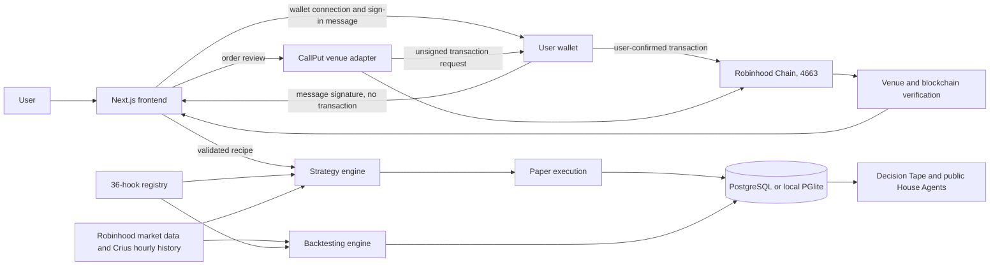

<p align="center">
  
</p>

# OPTRA Agent

OPTRA Agent is a wallet-connected application for configuring, testing, and running options strategies against tokenized stock markets. Its strategy engine composes application-level rules, evaluates them against verified market history, and keeps simulated execution separate from transactions a user signs with a wallet.

- **Contract Address (CA):** `0xc46f6a8149d5a400a230d3cdfc7a3a9abf3150fc`

## 01. Overview

OPTRA organizes strategy rules as reusable hooks across six stages: entry gates, contract selection, position sizing, position management, expiry handling, and risk breakers. Users can configure supported recipes and parameters, run a historical backtest, inspect the rule trace, and launch eligible strategies in Paper Mode.

The hook registry contains 36 strategy definitions. The application marks 26 as implemented and 10 as catalog-only. A recipe validator enforces supported compositions and parameter bounds; a listed hook is not automatically usable in every strategy.

## 02. Core Features

- Strategy builder for supported templates with validated, bounded rule parameters.
- A registry of 36 application-level strategy hooks inspired by the staged lifecycle model of Uniswap v4 Hooks.
- Tokenized stock markets discovered from Robinhood Chain's active asset registry.
- Historical backtesting against verified hourly stock-token history, using the same strategy evaluator as Paper execution.
- Paper Agents with virtual accounts and modeled option premiums.
- Four OPTRA House Agent strategies: Protective Put, Covered Call, Cash-Secured Put, and Earnings Straddle.
- Decision Tape records with per-rule outcomes, market context, recipe hashes, and data provenance.
- A separate CallPut workflow for wallet-signed options orders when the relevant build flags are enabled.
- Entry filters, position limits, collateral and share-coverage rules, loss limits, drawdown controls, and market-data breakers.

## 03. Modular Hook Architecture

Each hook belongs to one of six application stages. The composition borrows the idea of lifecycle-specific extension points from Uniswap v4 Hooks. OPTRA's strategy hooks run in the application's TypeScript engine. They are not Uniswap v4 pool callbacks or a set of deployed pool-hook contracts.

The registry marks each definition as `implemented` or `catalog_only`. Implemented hooks still run only in compositions accepted by the recipe validator and only when their required data is available.

### Gate: entry conditions (10)

| Hook | Responsibility | Registry status |
| --- | --- | --- |
| Volra | Filter entries using a realized-volatility rank proxy or modeled volatility. | implemented |
| Trendix | Require a fast/slow moving-average trend. | implemented |
| Earnex | Block entries around earnings or require a confirmed event for an earnings-only strategy. | implemented |
| Gapro | Detect a price gap after a trading-session break. | catalog-only |
| Rangel | Require price to remain inside an absolute or moving-average band. | catalog-only |
| Momira | Filter entries by RSI or a lookback price change. | catalog-only |
| Skewr | Compare put/call implied volatility or premiums; paired venue quotes are required. | catalog-only |
| Calmo | Bound recent realized volatility and hourly price moves. | implemented |
| Corpax | Block entries around known stock-token multiplier or corporate-action changes. | implemented |
| Sessia | Restrict entries to configured US equity sessions. | implemented |

### Strike: contract selection (7)

| Hook | Responsibility | Registry status |
| --- | --- | --- |
| Deltra | Select a theoretical strike near a target option delta. | implemented |
| Percy | Select a theoretical strike at a configured distance from spot. | implemented |
| Tenora | Choose a modeled expiry cycle and tenor. | implemented |
| Premo | Reject candidates below a minimum modeled premium. | implemented |
| Spreadix | Build a defined-risk vertical spread; multi-leg support is not available in the selected model. | catalog-only |
| Strangl | Build a long at-the-money straddle in the current evaluator. | implemented |
| Collara | Pair a protective put with a covered call; required execution support is not verified. | catalog-only |

### Size: allocation and exposure (4)

| Hook | Responsibility | Registry status |
| --- | --- | --- |
| Capra | Cap premium allocation and concurrent positions. | implemented |
| Kelvo | Scale position size inversely with realized volatility. | implemented |
| Laddr | Split entries into scheduled tranches. | catalog-only |
| Coverix | Size short calls or protective puts against configured virtual reference shares. | implemented |

### Pulse: position management (7)

| Hook | Responsibility | Registry status |
| --- | --- | --- |
| Profira | Close after a modeled gain or premium-capture threshold. | implemented |
| Stopra | Close at a configured premium-based loss threshold. | implemented |
| Trailo | Manage a modeled put with a trailing exit after the configured gain trigger. | implemented |
| Rolla | Close and reopen at a new strike or expiry after a trigger. | catalog-only |
| Thetix | Close short-premium positions after time-decay thresholds. | catalog-only |
| Hedgra | Hedge option delta with a spot-token position or put. | catalog-only |
| Rescu | Manage a pressured short option through a modeled credit roll or close. | implemented |

### Expiry: expiry and cycle handling (3)

| Hook | Responsibility | Registry status |
| --- | --- | --- |
| Settla | Hold a safely out-of-the-money option through modeled expiry. | implemented |
| Nextra | Open the next modeled cycle after the previous cycle closes or settles. | implemented |
| Lastra | Close a modeled position before its configured expiry. | implemented |

### Breaker: entry and risk controls (5)

| Hook | Responsibility | Registry status |
| --- | --- | --- |
| Haltr | Block entries on stale, missing, halted, or sharply moving market data. | implemented |
| Daylo | Stop new entries after the configured daily loss limit. | implemented |
| Drawra | Stop new entries after the configured peak-equity drawdown. | implemented |
| Exposa | Block entries when configured underlying exposure exceeds its cap. | implemented |
| Venux | Require healthy underlying data and a valid modeled-premium path. | implemented |

## 04. Product Workflow

For a user-owned Paper Agent, the usual path is:

**Connect Wallet → Configure Strategy → Backtest → Inspect Results → Launch Paper Agent → Monitor Decisions**

1. Connect an EVM wallet on Robinhood Chain (chain ID `4663`). The sign-in message proves wallet ownership; it is not a transaction authorization.
2. Select a supported strategy template and configure its permitted market, paper capital, virtual shares or collateral, and hook parameters.
3. Backtest the recipe against its verified hourly market history.
4. Review coverage, modeled performance and risk metrics, benchmarks, and the rule-level trace. A run without a modeled entry does not receive performance metrics and cannot pass the launch gate.
5. Launch the draft in Paper Mode only after a complete backtest matches the recipe hash and passes validation.
6. Monitor decisions, positions, and the stored history and recipe evidence in the Tape.

The CallPut workflow is separate from Paper execution. A user selects venue-listed option legs, reviews the order and funding requirements, then confirms each enabled open, close, or settle transaction in their own wallet. A submitted transaction is not treated as a fill until venue state and wallet holdings support that result. This workflow does not turn Paper Agents into wallet signers.

The build gates CallPut open, close, and settle separately with `NEXT_PUBLIC_CALLPUT_LIVE_ORDERS`, `NEXT_PUBLIC_CALLPUT_CLOSE`, and `NEXT_PUBLIC_CALLPUT_SETTLE`. A disabled action remains preview-only.

## 05. Backtesting & Market Coverage

### Market data

OPTRA reads active tokenized stock markets and current underlying/token quotes from Robinhood's market-data interface. Historical backtests use Crius hourly Robinhood Chain token OHLCV, with corporate-action and multiplier information checked before share-price normalization. The earnings strategies also use Robinhood's earnings calendar. Current quotes, historical candles, and option premiums are distinct data types.

### Listed markets and backtest eligibility

The Market view lists active stock-token assets available from the Robinhood Chain registry. CallPut option availability is determined separately from the venue's listed underlyings and live instruments. An active stock-token listing does not by itself make that market eligible for a backtest.

A backtest needs at least 1,441 consecutive, closed, nonempty hourly candles: 721 warmup candles and 720 hourly decision samples. The window must have verified token mapping and a stable multiplier, with no in-window corporate action that makes share normalization uncertain. OPTRA does not fill missing candles or use synthetic observations. Eligibility is reported per symbol and can change as provider history grows or its verification conditions change.

Strategy-specific data can impose additional limits. Earnings-only entries require a company-confirmed event. Missing earnings information or a missing verified history blocks the relevant entry rather than creating one.

### Evaluation and modeled premiums

House strategy backtests and Paper ticks use the same deterministic strategy evaluator. Protective Put uses its existing Paper evaluator. The model prices European options with Black–Scholes using annualized 30-day realized volatility multiplied by `1.1`, applies 50 basis points of modeled slippage, and excludes venue fees. These premiums are estimates, not recorded option quotes. The IV-rank rule is a realized-volatility proxy, not an option-chain IV rank. The Earnings Straddle model does not add an earnings volatility premium or model post-report IV crush.

A completed run reports available performance and risk metrics such as total return, maximum drawdown, ending cash, and strategy counts. Where valid, it also compares the same decision window with a price-only underlying benchmark and a flat, zero-yield USD baseline. The underlying benchmark excludes dividends, fees, and slippage; the cash comparison does not model a USDG/USD price path. A complete window with no modeled entry is recorded without performance metrics and remains ineligible for launch.

### Published House Agent results

The Agents and Lab screens expose the read-only `GET /api/public/v1/house-backtests` campaign captured on November 24, 2026. It replays 720 hourly decisions across eight markets that passed the existing candle-quality gate and four House Agent templates. The campaign records 18 runs with modeled metrics and 14 no-entry outcomes without performance metrics. Each row includes recipe, history, candle-snapshot, and earnings-event hashes. These results are versioned with the application release and are historical model output, not live performance.

## 06. System Architecture



## 07. Technology Stack

- Application: Next.js 16 App Router, React 19, and TypeScript 6.
- UI: Tailwind CSS 4, Radix UI, Lucide icons, and Three.js for selected visual components.
- Data and validation: TanStack Query, Zod 4, Drizzle ORM, PostgreSQL, and PGlite for local development.
- Wallet and EVM integration: wagmi 3 and viem 2, configured for Robinhood Chain (`4663`).
- Tests and tooling: Bun, Vitest, Playwright, ESLint, TypeScript, and a Foundry Solidity workspace under `contracts/`.
- Runtime packaging: a multi-stage Docker image using Node.js 26 and Bun 1.3.14. The hosted service uses Railway.

## 08. Getting Started

### Prerequisites

- Node.js `26` or later.
- Bun `1.3.14` for the package scripts and dependency workflow.
- PostgreSQL for a shared or production database. Local development can use PGlite without a PostgreSQL server.

### Install and configure

```sh
bun install --frozen-lockfile
```

Copy `.env.example` to the environment file used by your local setup. For local development, leave `DATABASE_URL` unset to use the persistent PGlite directory configured by `PGLITE_DATA_DIR` (default `.local/optra-db`). Set `APP_BASE_URL` to the app's origin for wallet-auth challenges. Keep provider and scheduler credentials server-side; never expose `CRIUS_API_KEY` or `CRON_SECRET` through a `NEXT_PUBLIC_` variable.

The relevant environment variables are:

| Variable | Purpose |
| --- | --- |
| `DATABASE_URL` | PostgreSQL connection string; required in production. Leave unset for local PGlite. |
| `PGLITE_DATA_DIR` | Local PGlite data directory. |
| `APP_BASE_URL` | Application origin used by wallet-auth challenges. |
| `CRIUS_API_KEY` | Optional server-side key for Crius historical candle requests. |
| `CRON_SECRET` | Bearer secret for protected scheduler and collector routes. |
| `MARKET_HISTORY_SYMBOLS` | Symbols used by the optional market-snapshot collector. |
| `LIVE_TRADING_ENABLED` | Keep `false` to leave automated real-money execution disabled. |
| `V4_CLAIM_LEVEL` | Keep `L0` for the current on-chain claim level. |

### Database and run commands

Local PGlite initializes and applies the repository migrations when the application opens its database. To apply migrations to a configured PostgreSQL database, set `DATABASE_URL` and run:

```sh
bun run db:migrate
bun dev
```

The development server uses the project's configured local app port. The main verification commands are:

```sh
bun run test
bun run lint
bun run typecheck
bun run build
bun run test:e2e
```

## 09. Project Structure

```text
app/          App Router pages and API routes
components/   Product screens, wallet UI, and shared interface components
lib/          Strategy, hook, market-data, backtest, Paper, wallet, and venue logic
db/           Drizzle schema
drizzle/      PostgreSQL migrations
contracts/    Solidity and Foundry integration workspace
public/       Static product assets, including the OPTRA banner
scripts/      Database, release, and integration utilities
tests/        Unit, integration, and browser tests
docs/         Product, API, security, and engineering references
```

## 10. Security & Execution Model

Paper Agents use virtual accounts and modeled premiums. House Agents belong to a reserved OPTRA account with no signing key, and their evaluator has no path to the CallPut wallet transaction flow. Wallet sign-in uses a message signature to establish a session; it does not authorize a trade.

Manual CallPut orders use a separate direct-wallet path. Each enabled action is reviewed and confirmed by the user in their wallet. OPTRA's public verification distinguishes wallet-signed capability, the autonomous engine, and demonstrated live execution instead of treating them as the same state.

Automated real-money execution remains disabled in the current configuration. Keep `LIVE_TRADING_ENABLED=false` and `V4_CLAIM_LEVEL=L0`. The 36 strategy hooks are application logic, not an assertion that an active Uniswap v4 pool hook or automated trading permission exists.

## 11. Verification & Testing

The repository includes Vitest tests for hook definitions, recipe validation, strategy decisions, backtest coverage, and persistence. House Agent integration tests exercise the shared strategy evaluator, Paper persistence, idempotency, restart recovery, public visibility boundaries, and Tape output. Playwright tests cover browser workflows, while the `contracts/` workspace contains Foundry tests for Solidity components.

Run the verification commands in the Getting Started section from the repository root. The backtest test fixtures contain captured provider data; fixture-based tests are not a substitute for checking current per-market provider coverage. No performance result or live venue fill is implied by a passing test or a successful build.
